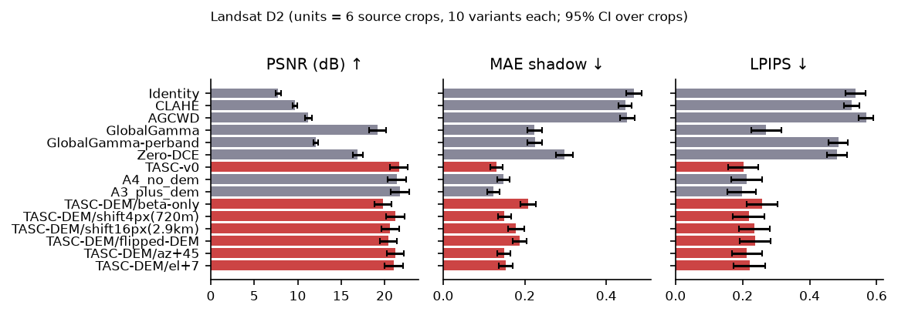
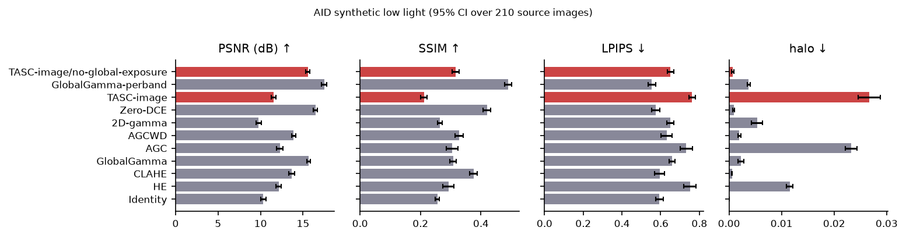

# Training-Free Illumination-Aware Gamma Correction for Remote Sensing Imagery: A Multi-Dataset Benchmark with Integrity Controls

## Abstract

We study how far a training-free, locally adaptive gamma correction can improve contrast in low-light and non-uniformly illuminated remote-sensing imagery while preserving structure and spectra, and when terrain-derived illumination adds benefit. We freeze an existing method, TASC-Gamma (TASC-v0), in two configurations (image-only and DEM-assisted), and evaluate it against ten baselines (plus shared-gain variants) and a set of benchmark-integrity controls on six datasets and a downstream probe: controlled Landsat pairs (60), Sentinel-2 L2A with Copernicus DEM (24 acquisitions, 6 regions, 2 held out), synthetically darkened AID (210 images × 3 degradations) and iSAID-dark (138 units), real night imagery from DarkRS (86) and ExDark (400), and an AID scene-classification probe. The results are mixed. On the Landsat benchmark that TASC-v0 was designed on, it outperforms all baselines (PSNR 21.65 dB versus 19.22 dB for global gamma and 16.89 dB for Zero-DCE), the shared band gain preserves NDVI and spectral angle by construction, and controls show that the DEM helps only when it is correctly registered; however, those shadows are synthesised from the same DEM. On real Sentinel-2 terrain the DEM-assisted variant lifts terrain shadows more selectively than the image-only variant, but a material-matched equalisation proxy does not improve, and with 4 development regions the evidence is exploratory. Outside this setting the image-only method performs poorly: on synthetically darkened AID and iSAID-dark it is 4.1 dB and 1.6 dB below global gamma in PSNR, it is below the unprocessed image on iSAID-dark, it lowers entropy and gives worse BRISQUE than the input on real night images, and it reduces linear-probe scene-classification accuracy by 15–24 percentage points. An ablation points to the global exposure step as the main cause. We report all negative findings, the baselines we could not run, and the proxy nature of our terrain metrics.

**Keywords** — low-light enhancement, gamma correction, remote sensing, digital elevation model, topographic shadow, benchmark.

## I. Introduction

Optical remote-sensing images are frequently under-exposed, either because they are acquired at night or in twilight, or because large parts of the scene lie in terrain shadow. Learned enhancement networks can brighten such images, but they need paired training data, can alter spectral relations, and are costly to run on large scenes. Classical histogram and gamma methods are cheap and training-free, but they operate globally or on small windows and typically treat each band independently, which distorts band ratios and indices such as NDVI.

TASC-Gamma (here frozen as TASC-v0) is a training-free pipeline that combines block-adaptive gamma with an optional terrain-derived shadow prior from a digital elevation model (DEM) and a single gain shared across bands, so that band ratios are unchanged. It was developed on Landsat data. This paper does not modify it. Instead it asks the research question: *how far can training-free, locally adaptive gamma correction improve contrast in low-light or non-uniformly illuminated remote-sensing imagery while preserving structure and spectra, and when does terrain-derived illumination add benefit?*

Our contributions are an evaluation, not a new algorithm:

1. a multi-dataset benchmark protocol with a fixed a-priori split into development and held-out regions, region-level statistics and a coverage report;
2. benchmark-integrity controls (no DEM, constant-weight, wrong, flipped and shifted DEM, perturbed sun angles, global versus local gamma, with and without the DCT detail step, with and without the shared gain) that probe whether the DEM is genuinely used;
3. an honest account of where the frozen method works (controlled terrain shading, spectral preservation) and where it does not (synthetic and real low-light imagery, downstream classification); and
4. a list of what was not done: unavailable baselines, proxy metrics, and the limited number of independent regions.

## II. Related Work

**Histogram and gamma enhancement.** Contrast-limited adaptive histogram equalisation (CLAHE) [@zuiderveld1994clahe] equalises tiled histograms with clipping and bilinear blending. Adaptive gamma correction with weighting distribution (AGCWD) [@huang2013agcwd] derives a gamma curve from the smoothed histogram, and adaptive gamma correction (AGC) [@rahman2016agc] adapts the gamma to image statistics. These methods are applied to luminance or to each band, and do not use terrain information.

**Spatially adaptive gamma for remote sensing (SAGC, SAMSIE).** Spatially adaptive gamma correction is established prior art in remote-sensing enhancement and is not claimed as novel here. SAGC [@huang2018sagc] targets low-contrast optical remote-sensing images: per its abstract, it separates a base and a detail layer with relative total variation, applies an adaptive gamma correction to the base layer, and recombines the result with the corrected detail layer, with the aim of brightening while preserving weak structures. SAMSIE [@huang2022samsie], by the same first author, is described as a spatially adaptive multi-scale scheme: a nonsubsampled contourlet transform splits the image into scales, an adaptive operator treats fine details, and the base layer is corrected by a spatially adaptive gamma correction built on improved histogram equalisation (SAGC-IHE). We read both from their published abstracts and bibliographic records; we did not obtain verified reference code for either, and therefore **did not evaluate SAGC or SAMSIE**. Our "2D-gamma" baseline is an independent, simplified spatially varying gamma and must not be read as a reproduction of either. To the extent that can be established from those abstracts, these methods adapt gamma from image content alone (no DEM or sun geometry) and do not state a mechanism that keeps inter-band ratios unchanged; whether they do so for multispectral input is not something we can assert. TASC-v0 shares their general idea of local gamma on a smoothed base layer and a separate detail step; the elements specific to TASC-v0 are the DEM-derived shadow prior and the single gain shared across bands. This paper evaluates TASC-v0 and makes no priority claim for the underlying ideas.

**Learned low-light enhancement.** Zero-DCE [@guo2020zerodce] estimates pixel-wise curve parameters without paired data, and we evaluate it with the official weights. DFFN [@yao2024dffn] is a learned spatial–frequency dual-domain feature-fusion network for low-light remote-sensing enhancement (amplitude and phase branches with an information-fusion affine block); its authors state that they built two low-light remote-sensing datasets and release code at `iijjlk/DFFN`, from whose README our iSAID-dark copy was obtained. We downloaded the DFFN weights but **did not run DFFN** (Section IX), so no DFFN result is reported; DFFN's published numbers are not comparable to ours.

**Topographic correction.** The C-correction [@teillet1982ccorr] and SCS+C [@soenen2005scsc] normalise illumination using the angle between the surface normal and the sun, computed from a DEM, and are usually applied to surface reflectance rather than as contrast enhancement. We include both as terrain-aware baselines. Hillshade follows Horn [@horn1981hillshading].

**Data.** We use AID [@xia2017aid], Sentinel-2 [@drusch2012s2] with the Copernicus GLO-30 DEM, ExDark [@loh2019exdark], and iSAID-dark as distributed with the DFFN repository. LPIPS [@zhang2018lpips], NIQE [@mittal2013niqe] and BRISQUE [@mittal2012brisque] are used for quality assessment, and a ResNet-50 [@he2016resnet] provides frozen features for the downstream probe.

## III. Method Under Test (TASC-v0, frozen)

The algorithm is implemented in `tasc/method.py` and is unchanged from the tagged release `TASC-v0` (commit `297a6d7`); a test asserts that the source is identical to the tag and that our adapter output is bit-identical to v0 on four-band input. Bands are ordered B, G, R (, NIR); the luminance Y uses the first three bands, so three-band RGB passes through the same code.

*Global exposure.* With target mid-level $\tau = 0.55$ and lower bound $\gamma_{\min} = 0.40$,

$$g_0 = \mathrm{clip}\left(\frac{\ln \tau}{\ln \bar{Y}},\ \gamma_{\min},\ 1\right).$$

*Block gamma.* $Y^{g_0}$ is divided into 16-px blocks; each block mean $\mu_b$ gives $g_{img}(b) = \mathrm{clip}(\ln\tau / \ln\mu_b,\ \gamma_{\min},\ 1)$. The upper bound of 1 protects bright regions. Block values are bilinearly interpolated to pixels.

*Terrain weighting (DEM-assisted only).* A shadow likelihood $S \in [0, 1]$ is computed from Horn slope/aspect hillshade and a ray-marched cast shadow using the sun azimuth and elevation, then smoothed ($\sigma = 2$ px). The block gamma is mixed with a gamma from the local mean of shadowed pixels (floor $\gamma_{\min,shadow} = 0.25$) and weighted by

$$w = \beta + (1-\beta)\,S,\qquad \beta = 0.30,$$

$$g_{loc} = 1 - w\,\bigl(1 - g_{img}\bigr).$$

Without a DEM, $w = 1$ (image-only). A guided filter [@he2013guided] ($r = 8$, $\epsilon = 10^{-3}$) removes block seams, and the final field is $\gamma = g_0 g_{loc}$, giving $Y_g = Y^{\gamma}$.

*Detail boost.* A global two-dimensional DCT low-pass (cut-off 0.12 of the spectrum) separates a base layer $L(Y_g)$, and

$$Y_{out} = Y_g + (k - 1)\,\bigl(Y_g - L(Y_g)\bigr),$$

$$k = 1 + (k_{\max} - 1)\,\sqrt{\mathrm{clip}\bigl(\tilde{Y}/\tau,\ 0,\ 1\bigr)},\qquad k_{\max} = 1.2,$$

where $\tilde{Y}$ is the Gaussian-blurred input luminance, so that the boost is smaller in originally dark (noisy) pixels.

*Shared gain.* $G = Y_{out}/Y$ is passed through a soft highlight knee and applied to every band, $B'_k = G\,B_k$. Because the same factor multiplies all bands, band ratios, NDVI and NDWI are unchanged except where a band clips (prevented by the knee).

All parameters were fixed on the Landsat D2 validation split before this study and were not changed for any other dataset.

## IV. Experimental Protocol

**Branch and freeze.** All work is on branch `research/illumination-aware-benchmark-v1`; `main` is untouched. A preflight stage verifies that the `tasc/` sources equal the `TASC-v0` tag, runs the unit tests and verifies archive checksums. All results come from one resumable orchestrator (`research/scripts/run_all_research.py --resume`).

**Reproduction of v0.** We rebuilt the Landsat D1/D2 data on the external drive and re-ran the original benchmark: 1,768 rows over 16 methods agree with the committed results to ≤ 2×10^-6 for all metrics except BRISQUE (maximum difference 0.0075, attributed to the OpenCV version).

**Datasets ([#tab:datasets]).** Details, checksums and licences are in the dataset audit. Low-light in AID and iSAID-dark is synthetic; DarkRS and ExDark are real but have no references.

Table: Datasets and evaluation units. {#tab:datasets}

| Dataset | Role | Units | Reference |
|---|---|---|---|
| Landsat D2 | controlled terrain shading | 60 pairs (28 methods) | yes (synthetic, same DEM) |
| Sentinel-2 L2A + GLO-30 | real terrain | 24 acquisitions, 6 regions (4 dev, 2 held out) | no |
| AID | synthetic low light | 210 test images × 3 degradations | yes (original) |
| iSAID-dark | synthetic low light | 66 val + 24 scenes × 3 levels | yes |
| DarkRS | real night, no-reference | 86 | no |
| ExDark | real low light, no-reference | 400 (of 7,363) | no |
| AID probe (E7) | downstream | 210 test images × 3 degradations | labels |

**Sentinel-2 design.** Four development regions (Valais Alps, Colorado Rockies, Atacama Andes, Ladakh) and two held-out regions (Jotunheimen, Southern Alps NZ) were fixed before any analysis; each region contributes four acquisitions at least 20 days apart, 1,536-px windows (10 m) with a 256-px DEM margin, sun elevation 5–50° and cloud cover ≤ 10 %. Sun azimuth and elevation come from the acquisition metadata; reflectance is DN × scale + offset. Scene Classification Layer (SCL) values are used only for validity and as spectral-material proxies, not as ground truth. Terrain-shadow masks are computed from the same DEM that TASC-DEM consumes (a circularity we return to in Section VIII).

**AID degradations.** Three deterministic, seeded low-light degradations (uniform, non-uniform and severe) are applied to each image; reference-based metrics compare the enhanced result to the original. **E7** trains a logistic-regression linear probe on frozen ImageNet ResNet-50 features of 900 clean AID images disjoint from the evaluation images, and evaluates the 210 untouched test images after degradation and enhancement. An ImageNet classifier is not used as an AID classifier.

**Baselines.** Identity, histogram equalisation (HE), CLAHE, global gamma, AGC, AGCWD, a 2D-gamma re-implementation in the style of locally adaptive gamma methods (labelled as such), Zero-DCE (official Epoch99 weights, PyTorch port verified to 3×10^-7 against the v0 NumPy port), C-correction and SCS+C (Sentinel-2 only), and "+shared" variants of the histogram methods that apply their luminance mapping through the shared gain. SAGC, SAMSIE and DFFN were not evaluated (Section IX).

**Metrics.** Full-reference: PSNR, SSIM, LPIPS (AlexNet), regional MAE (shadow, dark material), highlight clipping (mask defined on the input), NDVI error. No-reference: BRISQUE, NIQE, entropy, EME, average gradient. Process: gradient-reversal (halo) rate, noise amplification (Immerkær estimate relative to the input), blockiness, runtime. Spectral: NDVI error, spectral angle (SAM). Sentinel-2: *shadow lift* (mean luminance increase in DEM-shadow pixels), *selectivity* (lift of dark-but-lit pixels divided by shadow lift; lower is more selective), and *equalisation gain* (reduction in |log| brightness ratio of vegetation (NDVI > 0.5) in shadow versus lit).

**Statistics.** Units are independent scenes (images, pairs) or, for Sentinel-2, regions (tiles averaged to scenes, scenes to regions). We report means with 95 % bootstrap confidence intervals (10,000 resamples), paired Wilcoxon signed-rank tests for n ≥ 5 units, and Holm correction [@holm1979] within each (reference, metric) family. Held-out regions are reported separately and descriptively.

**Compute.** CPU only (12 cores; PyTorch 2.15 CPU); no GPU was used.

## V. Results

### A. Controlled Landsat benchmark (D2)

[#tab:d2] shows that TASC-v0 has the best PSNR, LPIPS and shadow MAE among all methods on the benchmark it was developed on; its SSIM (0.644) is statistically indistinguishable from the image-only variant (0.648). Paired differences: +2.43 dB over global gamma (95 % CI 2.12–2.76, p_Holm < 0.001), +4.76 dB over Zero-DCE (4.34–5.18) and +1.38 dB over a global gamma with the same DCT step (1.03–1.74). Histogram methods (HE, CLAHE, AGC, AGCWD) fall far below, with large NDVI errors when applied per band. The DEM-assisted version improves over the image-only version by only +0.22 dB PSNR (−0.02 to 0.48; p_Holm = 0.49), but reduces the MAE in shadowed pixels from 0.148 to 0.130 (difference −0.018, CI −0.026 to −0.009, p_Holm = 0.001) and LPIPS from 0.213 to 0.202. Because D2 shadows are generated from the same DEM, this is the most favourable setting for the DEM.

Table: Landsat D2 (60 pairs). PSNR in dB; MAE in shadow; NDVI error against the reference. {#tab:d2}

| Method | PSNR ↑ | SSIM ↑ | LPIPS ↓ | MAE shadow ↓ | NDVI err ↓ |
|---|---|---|---|---|---|
| Identity | 7.78 | 0.361 | 0.536 | 0.468 | 0.018 |
| HE | 9.05 | 0.290 | 0.610 | 0.486 | 0.284 |
| CLAHE | 9.69 | 0.378 | 0.526 | 0.446 | 0.141 |
| AGC | 10.71 | 0.384 | 0.618 | 0.464 | 0.227 |
| AGCWD | 11.24 | 0.352 | 0.569 | 0.452 | 0.096 |
| Global gamma | 19.22 | 0.598 | 0.270 | 0.224 | 0.018 |
| Zero-DCE | 16.89 | 0.490 | 0.481 | 0.297 | 0.041 |
| TASC image-only | 21.43 | 0.648 | 0.213 | 0.148 | 0.018 |
| TASC-v0 (DEM) | **21.65** | 0.644 | **0.202** | **0.130** | 0.018 |

{#fig:d2 width=0.8}

### B. Integrity controls and ablations on D2

[#tab:d2abl] lists controls. Replacing the shadow term with a constant weight (β-only) loses 1.86 dB (1.57–2.17), a flipped DEM loses 1.20 dB, and shifting the DEM by 720 m and 2.9 km loses 0.40 and 1.0 dB, so the benefit depends on correctly registered terrain. Azimuth errors of ±15° cost about 0.05 dB and +45° costs 0.42 dB. Two controls expose the limits of the metric. First, a sun elevation 7° *below* the metadata gives **higher** PSNR (22.45 dB) than the true elevation: a larger shadow field lifts under-exposed images more, so PSNR is not a measure of geometric correctness. Second, removing the DCT detail step is marginally *better* on PSNR (+0.12 dB, CI 0.09–0.16) and shadow MAE (0.124 versus 0.130), so the detail step is not supported on this benchmark. Applying the gamma per band instead of through the shared gain loses 6.40 dB and raises the NDVI error from 0.018 to 0.162. The block-smoothing steps (hard blocks versus smoothed field) differ by under 0.02 dB.

Table: D2 controls and ablations (60 pairs). {#tab:d2abl}

| Variant | PSNR | MAE shadow |
|---|---|---|
| TASC-v0 (true DEM and sun) | 21.65 | 0.130 |
| image-only (no DEM) | 21.43 | 0.148 |
| β-only (constant weight) | 19.79 | 0.209 |
| flipped DEM | 20.45 | 0.187 |
| DEM shifted 720 m | 21.25 | 0.150 |
| DEM shifted 2.9 km | 20.65 | 0.179 |
| azimuth +15° / −15° / +45° | 21.59 / 21.58 / 21.23 | 0.132 / 0.133 / 0.149 |
| elevation +7° / −7° | 21.07 / 22.45 | 0.153 / 0.102 |
| no DCT detail step | 21.77 | 0.124 |
| global gamma + DCT (A0) | 20.27 | 0.209 |
| per-band gamma (A5) | 15.25 | 0.131 |

### C. Real terrain: Sentinel-2 and Copernicus DEM

[#tab:s2] summarises Sentinel-2. All shared-gain TASC variants preserve NDVI (error ≤ 0.001) and keep the spectral angle at or below the input value, whereas Zero-DCE (NDVI error 0.136, SAM 20.2°), AGCWD and per-band variants do not. TASC creates no new clipped highlights, whereas HE and AGC newly clip 50–60 % of bright pixels.

On the development regions (n = 4) the DEM-assisted variant lifts terrain shadows by 0.218 versus 0.193 for image-only (difference 0.025, CI −0.003 to 0.054), and its lift is more selective (dark-lit/shadow ratio 0.29 versus 0.44). Over all six regions the shadow-lift difference is 0.034 (CI 0.011–0.056), but Holm-corrected p-values are 0.84–1.00 because n is small. The controls behave as expected on this proxy: a wrong DEM or a DEM shifted by 1 km reduces the shadow lift (0.169 and 0.184) and the selectivity falls back to the image-only level (0.44 and 0.43), and a constant weight (β-only) gives the smallest lift (0.150). In the two held-out regions (sun elevation 7–20°) the DEM variant again has the largest shadow lift (0.156 versus 0.105 image-only, wrong DEM 0.113), but the selectivity ratio is unstable (0.41 versus 1.37).

The material-matched check does **not** support a general equalisation benefit: vegetation in shadow versus lit becomes closer in brightness under image-only TASC (equalisation gain 0.197), global gamma (0.320) and CLAHE (0.623) than under TASC-DEM (0.012); in the held-out regions TASC-DEM is −0.433 and image-only −0.315. Part of the reason is that this metric rewards methods that brighten shadows regardless of terrain and uses a DEM-derived mask; with few vegetated shadow pixels in winter Alpine, Rocky and Atacama scenes it is also noisy. Topographic corrections C and SCS+C change little (shadow lift −0.007 and −0.006).

Table: Sentinel-2 (mean over regions). Lift is the mean luminance gain in DEM-shadow pixels. Dev = 4 development regions, HO = 2 held-out regions. {#tab:s2}

| Method | Lift dev | Lift HO | NDVI err dev | SAM dev (°) | SAM HO (°) |
|---|---|---|---|---|---|
| Identity | 0 | 0 | 0 | 8.93 | 5.99 |
| Global gamma | 0.126 | 0.065 | 0.000 | 8.14 | 5.31 |
| CLAHE | 0.056 | 0.024 | 0.081 | 14.62 | 12.08 |
| AGCWD | 0.119 | 0.110 | 0.049 | 12.33 | 9.26 |
| Zero-DCE | 0.124 | 0.116 | 0.136 | 20.21 | 18.22 |
| C-correction | −0.007 | 0.016 | 0.020 | 10.84 | 10.18 |
| TASC image-only | 0.193 | 0.105 | 0.000 | 8.12 | 5.30 |
| TASC-DEM | **0.218** | **0.156** | 0.001 | 8.21 | 5.34 |
| TASC-DEM, wrong DEM | 0.169 | 0.113 | 0.001 | 8.22 | 5.32 |
| TASC-DEM, shift 1 km | 0.184 | 0.132 | 0.001 | 8.19 | 5.32 |
| TASC-DEM, β-only | 0.150 | 0.076 | 0.002 | 8.28 | 5.39 |

{#fig:qual width=0.95}

### D. Synthetic low light: AID and iSAID-dark

On AID ([#tab:aid]) the image-only method is **not competitive** against full-reference metrics. It improves over the unprocessed input in PSNR (11.51 versus 10.32 dB; +1.19 dB, CI 0.64–1.73), but it is 4.15 dB below global gamma (CI −4.53 to −3.78), 4.94 dB below Zero-DCE (−5.40 to −4.51) and 2.15 dB below CLAHE, and its SSIM (0.211) and LPIPS (0.763) are worse than the input (0.256 and 0.594). It gives the lowest noise amplification (0.50) and no new clipped highlights. The ablation points to the global exposure step: removing it gives 15.56 dB, matching global gamma (15.66 dB), while a global-only variant reaches 12.08 dB. Per degradation, TASC-image is above the input in PSNR for all three (non-uniform 13.18 versus 12.30 dB, uniform 12.50 versus 10.27 dB, severe 8.85 versus 8.39 dB), but its SSIM is below the input for all three, and in the severe case all methods struggle (best 12.4 dB, per-band global gamma). A plausible explanation, supported by this ablation but not isolated in a dedicated experiment, is that the fixed target τ = 0.55 over-brightens synthetic images whose originals have lower mean intensity, which full-reference metrics penalise. On iSAID-dark (138 units) TASC-image has PSNR 9.51 dB, below the unprocessed input (11.78 dB; −2.26 dB, CI −2.85 to −1.71), below global gamma (11.13 dB) and 3.87 dB below Zero-DCE (13.38 dB).

Table: AID synthetic low light (210 images, three degradations averaged). {#tab:aid}

| Method | PSNR | SSIM | LPIPS | New clipped bright | Halo | Noise amp. |
|---|---|---|---|---|---|---|
| Identity | 10.32 | 0.256 | 0.594 | 0.000 | 0.000 | 1.00 |
| HE | 12.13 | 0.293 | 0.751 | 0.483 | 0.012 | 1.03 |
| CLAHE | 13.66 | 0.376 | 0.594 | 0.001 | 0.001 | 1.05 |
| AGC | 12.26 | 0.305 | 0.733 | 0.502 | 0.023 | 1.12 |
| AGCWD | 13.87 | 0.328 | 0.630 | 0.114 | 0.002 | 1.21 |
| Global gamma | 15.66 | 0.308 | 0.659 | 0.000 | 0.002 | 0.52 |
| Zero-DCE | **16.46** | **0.420** | **0.575** | 0.000 | 0.001 | 0.86 |
| TASC-image | 11.51 | 0.211 | 0.763 | 0.000 | 0.027 | 0.50 |
| TASC-image, no global exposure | 15.56 | 0.317 | 0.651 | 0.000 | 0.001 | 0.56 |
| TASC-image, per-band | 14.31 | 0.439 | 0.613 | 0.001 | 0.013 | 0.40 |

{#fig:aid width=0.8}

### E. Real low light: DarkRS and ExDark (no reference)

[#tab:nr] reports no-reference metrics on real night images. TASC-image brightens strongly but has the lowest entropy on DarkRS (6.06 versus 6.48 input; −0.42, CI −0.47 to −0.37) and the lowest EME (2.76 versus 7.56), and its BRISQUE is worse than the input (24.5 versus 18.3; +6.1, CI 4.8–7.5). NIQE is indistinguishable from the input on DarkRS (9.24 versus 9.12, p_Holm = 0.046, CI −0.01 to 0.23) and slightly better on ExDark (11.71 versus 12.27; −0.56, CI −0.80 to −0.31), where BRISQUE is again worse (29.1 versus 23.9). On ExDark, AGCWD attains the best BRISQUE (20.4) and HE the best NIQE (10.97). The low EME and entropy mean that TASC-image's lowest noise amplification (0.43, 0.78) is partly the effect of a flatter output rather than purely cleaner output. We find no support for contrast improvement from the image-only method on real night images with these metrics; the metrics are imperfect and no human study was done.

Table: Real low-light images, no reference. DarkRS n = 86; ExDark n = 400. {#tab:nr}

| Method | Entropy D / E | EME D / E | BRISQUE D / E | NIQE D / E | Noise amp. D / E |
|---|---|---|---|---|---|
| Identity | 6.48 / 5.80 | 7.56 / 9.04 | 18.3 / 23.9 | 9.12 / 12.27 | 1.00 / 1.00 |
| HE | 7.39 / 6.91 | 11.02 / 11.29 | 32.5 / 32.8 | 8.84 / 10.97 | 1.21 / 1.36 |
| CLAHE | 7.14 / 6.49 | 9.96 / 9.27 | 29.3 / 24.2 | 9.41 / 12.17 | 1.32 / 1.31 |
| AGCWD | 7.19 / 6.58 | 9.19 / 10.96 | 26.4 / 20.4 | 9.37 / 11.71 | 1.10 / 1.14 |
| Global gamma | 6.75 / 6.34 | 3.61 / 6.75 | 21.9 / 23.8 | 9.14 / 12.08 | 0.54 / 0.69 |
| Zero-DCE | 7.05 / 6.67 | 5.93 / 9.42 | 33.4 / 26.1 | 9.43 / 12.19 | 0.89 / 1.00 |
| TASC-image | 6.06 / 5.88 | 2.76 / 6.66 | 24.5 / 29.1 | 9.24 / 11.71 | 0.43 / 0.78 |

### F. Downstream: AID scene classification probe (E7)

A frozen-feature linear probe reaches 0.881 accuracy on clean test images. After degradation, accuracy for the unprocessed input is 0.838 (uniform), 0.857 (non-uniform) and 0.581 (severe). TASC-image lowers accuracy to 0.638, 0.710 and 0.343, i.e. −0.200 (CI −0.271 to −0.133), −0.148 (−0.214 to −0.081) and −0.238 (−0.314 to −0.167) relative to the input; all intervals exclude zero. The other methods stay within about ±0.06 of the input; the only nominal gains are AGCWD (+0.043, CI 0.005–0.081) and Zero-DCE (+0.043, CI −0.005–0.090) under the severe degradation, without correction for multiple comparisons. No method recovers clean accuracy under the severe degradation. Enhancement therefore does not help this probe, and the image-only method harms it. Detection and segmentation were not run.

Table: Linear-probe accuracy on 210 AID test images. {#tab:e7}

| Method | Uniform | Non-uniform | Severe |
|---|---|---|---|
| Clean reference | 0.881 | 0.881 | 0.881 |
| Identity | 0.838 | 0.857 | 0.581 |
| Global gamma | 0.810 | 0.805 | 0.524 |
| CLAHE | 0.829 | 0.852 | 0.605 |
| AGCWD | 0.824 | 0.852 | 0.624 |
| HE | 0.814 | 0.795 | 0.595 |
| Zero-DCE | 0.857 | 0.833 | 0.624 |
| TASC-image | 0.638 | 0.710 | 0.343 |

### G. Efficiency

On a single CPU process (1 MP image, four threads), TASC-image takes about 114 ms/MP, versus 13 ms/MP for CLAHE, 21 ms/MP for HE, 22 ms/MP for AGCWD, 51 ms/MP for global gamma and about 33 s/MP for Zero-DCE on CPU (a GPU would change this ranking; none was used). The DEM-assisted variant was not timed separately: the ray-marched shadow field adds a cost that scales with relief and window size. Peak memory was not reliably measured (Section VIII).

## VI. Statistical Analysis

All results use independent units: pairs for D2, source images for AID (the three degradations averaged), scenes for iSAID-dark and the no-reference sets, and regions for Sentinel-2. D2 and iSAID-dark units are not fully independent (tiles from few Landsat scenes; 72 of 138 iSAID-dark units are three darkness levels of 24 scenes), so their intervals are likely too narrow. With four development and two held-out regions, Wilcoxon tests are not computed and the Sentinel-2 comparisons must be read as exploratory descriptions with bootstrap intervals. Where the tests could be run (D2, AID, iSAID-dark, DarkRS, ExDark, E7), large differences are well beyond Holm-corrected significance; the notable non-significant findings are DEM versus image-only PSNR on D2 (p_Holm = 0.49) and every Sentinel-2 difference after correction for the six-region comparison.

## VII. Discussion

*What the experiments support.* (i) When illumination is non-uniform because of known terrain shading, a training-free, shared-gain, locally adaptive gamma outperforms the baselines we tested on the Landsat benchmark, and the shared gain preserves spectra and indices in every dataset where it was measured. (ii) The DEM is used: the controls show degradation for wrong, flipped and shifted terrain. (iii) On real Sentinel-2 scenes with real sun angles, the DEM-assisted variant lifts terrain shadow more than the image-only variant (about +0.03 luminance units, exploratory).

*What they do not support.* (i) The DEM benefit on full-reference PSNR is small and not significant on D2, where it is maximally favourable. (ii) We found no evidence that DEM-aided TASC equalises same-material brightness across shadow better than simpler methods. (iii) The image-only method is not a competitive general low-light enhancer: it is below global gamma, Zero-DCE and CLAHE on synthetic low light, below the unprocessed input on iSAID-dark, worse than the input on BRISQUE for real night images, and harmful for a classification probe. (iv) The DCT detail step has no measured benefit on D2.

*Visual behaviour.* In the qualitative examples (Fig. 1) TASC lifts terrain shadows more than CLAHE and similarly to global gamma, but shadowed snow keeps its blue cast by construction (ratios are preserved), and the image-only and DEM-assisted outputs are hard to tell apart by eye; the measured differences are small.

*Why.* The ablation on AID (removing the global exposure step gives +4.0 dB and recovers global gamma's score) indicates that the fixed target mid-level, tuned on D2, is the dominant factor for synthetic low light; we did not tune it, since the method was frozen. This is a hypothesis for future work, not a result. A related caution is that full-reference metrics on synthetic darkening favour methods that invert the darkening model.

*Recommendations (not implemented here, per the protocol).* Phase-4 candidates are an exposure-target calibration that is data-driven and region-aware, a re-examination of the detail step, and a Sentinel-2 evaluation against independently annotated shadows.

## VIII. Threats to Validity

*Circularity.* D2 shadows and Sentinel-2 shadow masks both derive from the same DEM that drives TASC-DEM. *Few regions.* Six regions, two held out. *Synthetic degradations.* AID and iSAID-dark are not real low light, and the references are the bright originals. *Metrics.* NIQE, BRISQUE, EME and entropy are imperfect proxies, no user study was done, and LPIPS for 1080p iSAID images was not discriminative (values around 1) and is not reported here. *Measurement.* Runtimes inside experiment stores were collected with four concurrent workers; only the single-process efficiency run is comparable. The peak-RSS values of the efficiency run are identical for all methods (4,397 MB), so memory is not reported. *Baselines.* Re-implementations of AGC, AGCWD, HE, CLAHE and 2D gamma are not claimed to match published numbers. *Elevation sensitivity.* PSNR rewards a mis-specified (lower) sun elevation on D2.

## IX. Limitations and Missing Baselines

SAGC and SAMSIE could not be evaluated because no verified official implementation was available; the labelled "2D-gamma" is an independent approximation and should not be read as either. The DFFN code and weights were downloaded and checksummed but were not executed: running downloaded third-party code was blocked by our sandbox policy and was not circumvented; DFFN is therefore reported as not evaluated. The downstream study covers classification only. The iSAID-dark version used is the one distributed with the DFFN repository (folder `iSAID2`) and was not matched to a published version number. The full limitation list is in the repository (`research/reports/limitations.md`).

## X. Conclusion

A frozen training-free gamma method, evaluated across seven data sources with integrity controls, preserves spectra by construction and does well on the controlled terrain-shading task it was developed for, with evidence that correct terrain information matters. Beyond that setting its advantage did not generalise: for synthetic and real low light and for a downstream probe, the image-only configuration was weaker than much simpler baselines, and the DEM benefit on real terrain is promising but small and statistically unresolved with the available regions. These findings define the work needed before the method can be recommended outside controlled terrain shading.

## Data and Code Availability

Code, configurations, manifests, result tables and reports are in the repository on branch `research/illumination-aware-benchmark-v1`. Dataset files are not redistributed; checksums and acquisition scripts are provided. The reproduction command is `python research/scripts/run_all_research.py --config research/configs/research_full.yaml --resume`.
