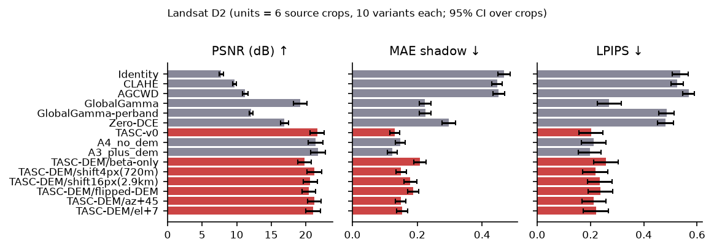

## V. Results

All paired differences are *TASC minus comparator* with 95 % bootstrap intervals over the independent units of each experiment (Section VI). Unless stated otherwise, "baselines" include the per-band variants (per-band global gamma, per-band CLAHE/HE), and rankings are given over all of them.

### A. Controlled Landsat benchmark (D2)

D2 consists of six source crops of a single Landsat scene, each re-illuminated with ten synthetic shading variants (60 pairs). The ten variants of a crop are dependent, so the statistical unit is the source crop (n = 6) and variants are averaged first. [#tab:d2] shows that TASC-v0 has the highest PSNR of all non-TASC methods, including per-band global gamma, which reaches only 12.12 dB with an NDVI error of 0.258. TASC-v0 is 2.43 dB above global gamma (95 % CI 1.89–2.87), 4.76 dB above Zero-DCE (3.94–5.51) and 1.37 dB above a global gamma with the same DCT step (0.91–1.64); it is better than each of them in all six crops. With n = 6 the smallest attainable two-sided Wilcoxon p-value is 0.031, which after Holm correction over 27 comparisons is 0.84, so **no D2 comparison is statistically significant after correction**; the evidence is a consistent 6/6 direction with bootstrap intervals that exclude zero. The DEM-assisted version improves over its image-only variant by 0.22 dB PSNR (CI 0.16–0.28; 6/6 crops) and lowers shadow MAE from 0.148 to 0.130 (−0.018, CI −0.022 to −0.013). Because D2 shadows are generated from the same DEM, this is the most favourable setting for the DEM. At the dependent variant level (60 pairs; `d2_vs_tascv0_variant_level_dependent.csv`) the DEM-versus-image-only PSNR difference is +0.22 dB with a CI of −0.02 to 0.48, so conclusions about the DEM gain on D2 depend on the unit of analysis.

Spectral behaviour on D2 must be read in two ways. *Preservation relative to the input* is exact for every shared-gain method (spectral angle to the input 0.00°; band ratios unchanged), while per-band TASC changes the input spectra by 10.8°, per-band global gamma by 15.9° and Zero-DCE by 3.1°. *Reconstruction accuracy relative to the clean reference* is different: the degraded input is itself 1.52° from the reference, and every shared-gain method inherits exactly that error (1.52°), i.e. TASC neither corrects nor worsens the spectral error of the degraded image; Zero-DCE (3.46°) and per-band gamma (15.9°) are worse. Band-ratio preservation is not reflectance recovery.

Table: Landsat D2 (6 source crops × 10 variants; means over crops). PSNR in dB; MAE in shadow; NDVI error and spectral angle (SAM, corrected metric) against the clean reference; SAM vs input is preservation. {#tab:d2}

| Method | PSNR ↑ | SSIM ↑ | LPIPS ↓ | MAE shadow ↓ | NDVI err ↓ | SAM vs reference (°) ↓ | SAM vs input (°) |
|---|---|---|---|---|---|---|---|
D2_ROWS

{#fig:d2 width=0.8}

### B. Integrity controls and ablations on D2

[#tab:d2abl] lists controls (crop-level n = 6 for all intervals). Replacing the shadow term with a constant weight (β-only) loses 1.86 dB (CI 1.42–2.22), a flipped DEM loses 1.20 dB, and shifting the DEM by 720 m and 2.9 km loses 0.40 and 1.0 dB, so the benefit depends on correctly registered terrain. Azimuth errors of ±15° cost about 0.05 dB and +45° costs 0.42 dB. Two controls expose the limits of the metric. First, a sun elevation 7° *below* the metadata gives **higher** PSNR (22.45 dB) than the true elevation: a larger shadow field lifts under-exposed images more, so PSNR is not a measure of geometric correctness. Second, removing the DCT detail step is marginally *better* on PSNR (+0.12 dB, CI 0.10–0.14) and shadow MAE (0.124 versus 0.130), so the detail step is not supported on this benchmark. Applying the gamma per band instead of through the shared gain loses 6.40 dB and raises the NDVI error from 0.018 to 0.162. The block-smoothing steps (hard blocks versus smoothed field) differ by under 0.02 dB.

Table: D2 controls and ablations (means over 60 pairs; the table reports pair-level means, intervals are in `tables/d2_vs_tascv0.csv`). {#tab:d2abl}

| Variant | PSNR | MAE shadow |
|---|---|---|
| TASC-v0 (true DEM and sun) | 21.65 | 0.130 |
| image-only (no DEM) | 21.43 | 0.148 |
| β-only (constant weight) | 19.79 | 0.209 |
| flipped DEM | 20.45 | 0.187 |
| DEM shifted 720 m | 21.25 | 0.150 |
| DEM shifted 2.9 km | 20.65 | 0.179 |
| azimuth +15° / −15° / +45° | 21.59 / 21.58 / 21.23 | 0.132 / 0.133 / 0.149 |
| elevation +7° / −7° | 21.07 / 22.45 | 0.153 / 0.102 |
| no DCT detail step | 21.77 | 0.124 |
| global gamma + DCT (A0) | 20.27 | 0.209 |
| per-band gamma (A5) | 15.25 | 0.131 |

### C. Real terrain: Sentinel-2 and Copernicus DEM

Sentinel-2 has no ground-truth illumination. The statistical unit is the region (tiles averaged to scenes, scenes to regions): 4 development regions and 2 held-out regions, so every Sentinel-2 statement below is **exploratory**, and no Wilcoxon p-values exist for n < 5. All shadow masks are derived from the Copernicus DEM, the same source that drives TASC-DEM; metrics that use them favour DEM-aware methods (circularity).

**Spectral preservation (corrected metric).** Spectral angle, NDVI/NDWI error and band-ratio deviation of the output relative to the *input* are exactly zero (to floating-point rounding) for every shared-gain method — TASC image-only, TASC-DEM and their ablations, global gamma, CLAHE+shared and AGCWD+shared — in both the development and held-out regions, because these methods multiply all bands of a pixel by one factor. This is a property of the construction and not an empirical advantage over the input: the input compared with itself also gives 0°, the metrics cannot discriminate among shared-gain methods, and band-ratio preservation is not recovery of surface reflectance (the input's own atmospheric and sensor effects are preserved). Methods that do not share the gain change the spectra: per-band global gamma 10.3° (development) and 7.0° (held out), CLAHE 6.8° and 6.8°, AGC 11.7° and 5.8°, AGCWD 4.2° and 3.9°, HE 12.7° and 10.1°, the per-band TASC variants 13.8° (DEM-assisted) and 19.2° (image-only) in the development regions, the topographic corrections 2.4–2.5° and 4.4°, and Zero-DCE 2.1° and 2.3° (NDVI error 0.025 and 0.027; NDWI error 0.025 and 0.009). These values are conditional on the pixels used: clipped (zero) reflectances and vectors with norm below 0.01 are excluded (about 10 % of valid pixels in the development regions and 8 % in the held-out regions for the input; 21 % and 19 % for Zero-DCE, and 22 % and 21 % for AGCWD+shared, whose outputs fall below the norm threshold); counts are in `tables/s2_sam_exclusions.csv`, and a threshold of 0.03 gives the same ordering. *An earlier version of this paper reported TASC at 8.2° against 8.9° for the input; that comparison came from a defective metric and is withdrawn* (Section VIII and `reports/scientific_corrections.md`).

On the development regions (n = 4) the DEM-assisted variant lifts terrain shadows by 0.218 versus 0.193 for image-only (difference 0.025, CI −0.003 to 0.054), and its lift is more selective (dark-lit/shadow ratio 0.29 versus 0.44). Among the methods that preserve spectra, TASC-DEM (true sun angles) has the largest shadow lift; AGC (0.212) and HE (0.193) lift similarly but clip 50–60 % of bright pixels, and the per-band variants (TASC-DEM per band 0.331, TASC-image per band 0.302) lift more but change the spectra substantially. Over all six regions the shadow-lift difference between TASC-DEM and image-only is 0.034 (CI 0.011–0.056), but Holm-corrected p-values are 0.84–1.00. The controls behave as expected on this circular proxy: a wrong DEM or a DEM shifted by 1 km reduces the shadow lift (0.169 and 0.184) and the selectivity falls back to the image-only level (0.44 and 0.43), and a constant weight (β-only) gives the smallest lift (0.150). In the two held-out regions (sun elevation 7–20°) the DEM variant again has the largest shadow lift among spectra-preserving methods (0.156 versus 0.105 image-only, wrong DEM 0.113), but the selectivity ratio is unstable (0.41 versus 1.37).

The material-matched check does **not** support a general equalisation benefit: vegetation in shadow versus lit becomes closer in brightness under image-only TASC (equalisation gain 0.197), global gamma (0.320), per-band global gamma (0.586) and CLAHE (0.623) than under TASC-DEM (0.012); in the held-out regions TASC-DEM is −0.433 and image-only −0.315. Part of the reason is that this metric rewards methods that brighten shadows regardless of terrain and uses a DEM-derived mask; with few vegetated shadow pixels in winter Alpine, Rocky and Atacama scenes it is also noisy. Topographic corrections C and SCS+C change little (shadow lift −0.007 and −0.006).

Table: Sentinel-2 (mean over regions). Lift is the mean luminance gain in DEM-shadow pixels. SAM is the corrected spectral angle between output and input (preservation, not accuracy). Dev = 4 development regions, HO = 2 held-out regions. {#tab:s2}

| Method | Lift dev | Lift HO | NDVI err dev | SAM dev (°) | SAM HO (°) |
|---|---|---|---|---|---|
S2_ROWS

{#fig:qual width=0.95}

### D. Synthetic low light: AID and iSAID-dark

On AID ([#tab:aid]) the image-only method is **not competitive** against full-reference metrics. The best baseline on every full-reference metric is per-band global gamma (PSNR 17.51 dB, SSIM 0.490, LPIPS 0.555), followed by Zero-DCE (16.46 dB, 0.420, 0.575). TASC-image improves over the unprocessed input in PSNR (11.51 versus 10.32 dB; +1.19 dB, CI 0.64–1.73), but it is 4.15 dB below global gamma (CI −4.53 to −3.78), 4.94 dB below Zero-DCE (−5.40 to −4.51), 5.99 dB below per-band global gamma (−6.49 to −5.52) and 2.15 dB below CLAHE, and its SSIM (0.211) and LPIPS (0.763) are worse than the input (0.256 and 0.594). Among the spectra-preserving (shared-gain) methods TASC-image has the lowest noise amplification (0.50; per-band variants reach 0.40) and no new clipped highlights. The three degradations of a source image are averaged before testing (210 independent source images). The ablation points to the global exposure step: removing it gives 15.56 dB, matching global gamma (15.66 dB), while a global-only variant reaches 12.08 dB. Per degradation, TASC-image is above the input in PSNR for all three (non-uniform 13.18 versus 12.30 dB, uniform 12.50 versus 10.27 dB, severe 8.85 versus 8.39 dB), but its SSIM is below the input for all three, and in the severe case all methods struggle (best 12.4 dB, per-band global gamma). A plausible explanation, supported by this ablation but not isolated in a dedicated experiment, is that the fixed target τ = 0.55 over-brightens synthetic images whose originals have lower mean intensity, which full-reference metrics penalise.

On iSAID-dark, the units are parent images (46: the crops of the validation split and the three darkness levels of each high-pixel scene are averaged per parent), not the 138 files. TASC-image has PSNR 9.51 dB, below the unprocessed input (11.78 dB; −2.26 dB, CI −3.19 to −1.36), below global gamma (11.13 dB) and 3.87 dB below Zero-DCE (13.38 dB; CI −4.21 to −3.54) and 4.89 dB below the best baseline, per-band global gamma (14.40 dB; CI −5.12 to −4.64).

Table: AID synthetic low light (210 source images, three degradations averaged within image). {#tab:aid}

| Method | PSNR | SSIM | LPIPS | New clipped bright | Halo | Noise amp. |
|---|---|---|---|---|---|---|
AID_ROWS

Table: iSAID-dark (46 parent images; crops and darkness levels averaged within parent). LPIPS is omitted: its values for the 1080p images are about 1 for all methods and not discriminative. {#tab:isaid}

| Method | PSNR | SSIM | Halo | Noise amp. |
|---|---|---|---|---|
ISAID_ROWS

{#fig:aid width=0.8}

### E. Real low light: DarkRS and ExDark (no reference)

[#tab:darkrs] and [#tab:exdark] report no-reference metrics on real night images. TASC-image brightens strongly but has low entropy on DarkRS (6.06 versus 6.48 input; −0.42, CI −0.47 to −0.37; only 2D-gamma is lower, 5.71) and the lowest EME (2.76 versus 7.56 for the input), and its BRISQUE is worse than the input (24.5 versus 18.3; +6.1, CI 4.8–7.5). NIQE is indistinguishable from the input on DarkRS (9.24 versus 9.12, p_Holm = 0.046, CI −0.01 to 0.23) and slightly better on ExDark (11.71 versus 12.27; −0.56, CI −0.80 to −0.31), where BRISQUE is again worse (29.1 versus 23.9). On ExDark, AGCWD attains the best BRISQUE (20.4) and HE the best NIQE (10.97). TASC-image has the lowest noise amplification on DarkRS (0.43) but not on ExDark (0.78; global gamma 0.69), and its low EME and entropy mean that low noise amplification is partly the effect of a flatter output rather than purely cleaner output. We find no support for contrast improvement from the image-only method on real night images with these metrics; the metrics are imperfect and no human study was done.

Table: DarkRS, real night images, no reference (n = 86). {#tab:darkrs}

| Method | Entropy | EME | BRISQUE | NIQE | Noise amp. |
|---|---|---|---|---|---|
DARKRS_ROWS

Table: ExDark, real low-light images, no reference (400 of 7,363 images). {#tab:exdark}

| Method | Entropy | EME | BRISQUE | NIQE | Noise amp. |
|---|---|---|---|---|---|
EXDARK_ROWS

### F. Downstream: AID scene classification probe (E7)

A frozen-feature linear probe reaches 0.881 accuracy on clean test images. Each degradation is analysed separately over the same 210 test images (the three degradations of one image are never pooled as independent samples). After degradation, accuracy for the unprocessed input is 0.838 (uniform), 0.857 (non-uniform) and 0.581 (severe). TASC-image lowers accuracy to 0.638, 0.710 and 0.343, i.e. −0.200 (CI −0.271 to −0.133), −0.148 (−0.214 to −0.081) and −0.238 (−0.314 to −0.167) relative to the input; all intervals exclude zero. The other methods stay within about ±0.06 of the input; the only nominal gains are AGCWD (+0.043, CI 0.005–0.081) and Zero-DCE (+0.043, CI −0.005 to 0.090) under the severe degradation, without correction for multiple comparisons. Per-band global gamma, the strongest full-reference baseline, is also within this range (0.824, 0.852, 0.610). No method recovers clean accuracy under the severe degradation. Enhancement therefore does not help this probe, and the image-only method harms it. Detection and segmentation were not run.

Table: Linear-probe accuracy on 210 AID test images. {#tab:e7}

| Method | Uniform | Non-uniform | Severe |
|---|---|---|---|
| Clean reference | 0.881 | 0.881 | 0.881 |
| Identity | 0.838 | 0.857 | 0.581 |
| Global gamma | 0.810 | 0.805 | 0.524 |
| Global gamma, per band | 0.824 | 0.852 | 0.610 |
| CLAHE | 0.829 | 0.852 | 0.605 |
| AGCWD | 0.824 | 0.852 | 0.624 |
| HE | 0.814 | 0.795 | 0.595 |
| Zero-DCE | 0.857 | 0.833 | 0.624 |
| TASC-image | 0.638 | 0.710 | 0.343 |

### G. Efficiency

On a single CPU process (1 MP image, four threads), TASC-image takes about 114 ms/MP, versus 13 ms/MP for CLAHE, 21 ms/MP for HE, 22 ms/MP for AGCWD, 51 ms/MP for global gamma and about 33 s/MP for Zero-DCE on CPU (a GPU would change this ranking; none was used). The DEM-assisted variant was not timed separately: the ray-marched shadow field adds a cost that scales with relief and window size. Peak memory was not reliably measured (Section VIII).

## VI. Statistical Analysis

Independent units: source crops for D2 (n = 6, ten dependent variants averaged within crop, all from one Landsat scene), source images for AID (210; the three degradations averaged within image) and for E7 (each degradation analysed separately), parent images for iSAID-dark (46), images for DarkRS (86) and ExDark (400; images from the same photographic series cannot be excluded), and regions for Sentinel-2 (4 development, 2 held out, 6 pooled). Intervals are percentile bootstrap intervals over these units; Wilcoxon tests are only computed for n ≥ 5 and corrected with Holm within each (reference, metric) family. With six D2 crops the smallest attainable p-value is 0.031, so no D2 comparison survives correction; for Sentinel-2 no test is available for 4 or 2 regions and the six-region Holm-corrected p-values are 0.84–1.00. Where tests are possible with larger n (AID, iSAID-dark, DarkRS, ExDark, E7), the large differences reported above are far beyond Holm-corrected significance; the notable non-significant findings are NIQE on DarkRS and ExDark against several baselines, and entropy on ExDark against the input (p_Holm = 0.092).

## VII. Discussion

*What the experiments support.* (i) On the controlled terrain-shading benchmark, a training-free, shared-gain, locally adaptive gamma outperforms the baselines we tested, in every one of six crops, though not at a formally significant level. (ii) The DEM is used: the controls show degradation for wrong, flipped and shifted terrain. (iii) Shared-gain methods leave the spectral angle to the input at zero on D2 and keep NDVI unchanged; this is preservation of the input's band ratios, which is not the same as recovering surface reflectance, and the recovered image inherits whatever spectral error the degraded input has. (iv) On real Sentinel-2 scenes with real sun angles, the DEM-assisted variant lifts terrain shadow more than the image-only variant (about +0.03 luminance units, exploratory, circular mask).

*What they do not support.* (i) The DEM benefit on D2 depends on the unit of analysis and is built into that benchmark. (ii) We found no evidence that DEM-aided TASC equalises same-material brightness across shadow better than simpler methods. (iii) The image-only method is not a competitive general low-light enhancer: it is below per-band global gamma, Zero-DCE, global gamma and CLAHE on synthetic low light, below the unprocessed input on iSAID-dark, worse than the input on BRISQUE for real night images, and harmful for a classification probe. (iv) The DCT detail step has no measured benefit on D2.

*Visual behaviour.* In the qualitative examples ([#fig:qual]) TASC lifts terrain shadows more than CLAHE and similarly to global gamma, but shadowed snow keeps its blue cast by construction (ratios are preserved), and the image-only and DEM-assisted outputs are hard to tell apart by eye; the measured differences are small.

*Why.* The ablation on AID (removing the global exposure step gives +4.0 dB and recovers global gamma's score) indicates that the fixed target mid-level, tuned on D2, is the dominant factor for synthetic low light; we did not tune it, since the method was frozen. This is a hypothesis for future work, not a result. A related caution is that full-reference metrics on synthetic darkening favour methods that invert the darkening model.

*Relation to prior work.* Spatially adaptive gamma correction for remote-sensing images (SAGC, SAMSIE) and topographic correction are established; this study evaluates one terrain-aware, spectrally consistent variant and does not claim novelty for these ideas. SAGC, SAMSIE and DFFN were not evaluated, so we make no comparative statement about them.

*Recommendations (not implemented here, per the protocol).* Phase-4 candidates are an exposure-target calibration that is data-driven and region-aware, a re-examination of the detail step, and a Sentinel-2 evaluation against independently annotated shadows.

## VIII. Threats to Validity

*Circularity.* D2 shadows and Sentinel-2 shadow masks both derive from the same DEM that drives TASC-DEM. *Few independent units.* D2 has six source crops from one scene; Sentinel-2 has six regions, two held out. *Synthetic degradations.* AID and iSAID-dark are not real low light, and the references are the bright originals. *Spectral metric.* The frozen `tasc.metrics.sam_deg` was found to be defective (it reports 8.93° for identical Sentinel-2 input); all spectral-angle values in this paper come from a corrected metric (`research/trs/spectral.py`, `reports/scientific_corrections.md`); clipped (zero) reflectance and vectors with norm below 0.01 are excluded and counted. *Metrics.* NIQE, BRISQUE, EME and entropy are imperfect proxies, no user study was done, and LPIPS for 1080p iSAID images was not discriminative. *Measurement.* Runtimes inside experiment stores were collected with four concurrent workers; only the single-process efficiency run is comparable. The peak-RSS values of the efficiency run are identical for all methods (4,397 MB), so memory is not reported. *Baselines.* Re-implementations of AGC, AGCWD, HE, CLAHE and 2D gamma are not claimed to match published numbers. *Elevation sensitivity.* PSNR rewards a mis-specified (lower) sun elevation on D2.

## IX. Limitations and Missing Baselines

SAGC [@huang2018sagc] and SAMSIE [@huang2022samsie] could not be evaluated because no verified official implementation was available; the labelled "2D-gamma" is an independent approximation and should not be read as either. The DFFN [@yao2024dffn] code and weights were downloaded and checksummed but were not executed: running downloaded third-party code was blocked by our sandbox policy and was not circumvented; DFFN is therefore reported as not evaluated. The downstream study covers classification only. The iSAID-dark version used is the one distributed with the DFFN repository (folder `iSAID2`) and was not matched to a published version number. The full limitation list is in the repository (`research/reports/limitations.md`).

## X. Conclusion

A frozen training-free gamma method, evaluated across six datasets and a downstream probe with integrity controls, keeps the input's band ratios by construction and does well on the controlled terrain-shading task it was developed for, with evidence that correct terrain information matters; that evidence rests on six crops of a single scene and does not reach formal significance. Beyond that setting its advantage did not generalise: for synthetic and real low light and for a downstream probe, the image-only configuration was weaker than much simpler baselines, and the DEM benefit on real terrain is small, exploratory and statistically unresolved with six regions. These findings define the work needed before the method can be recommended outside controlled terrain shading.

